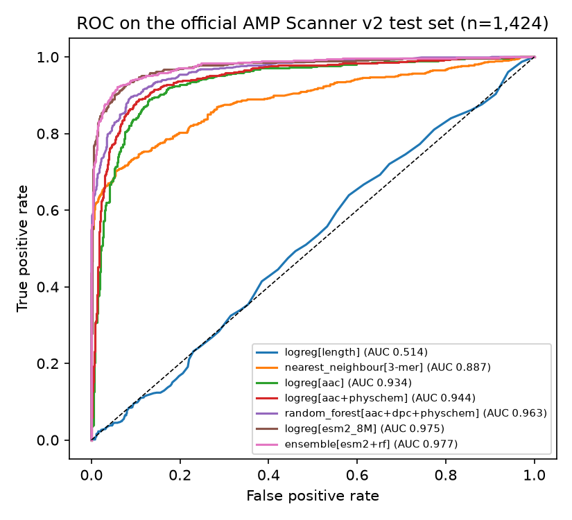
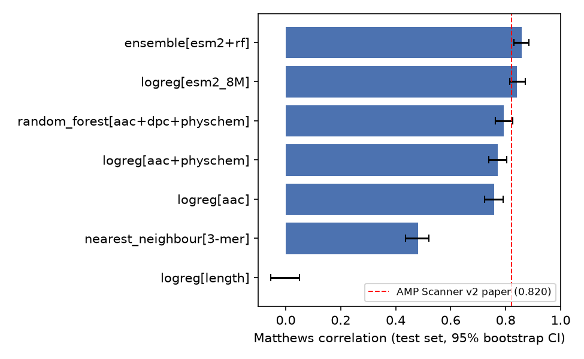
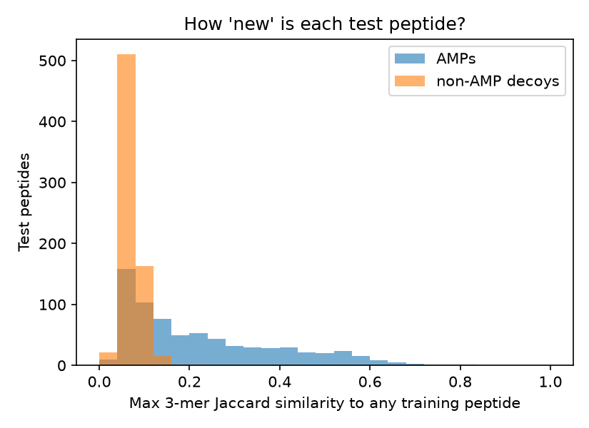

# Antimicrobial Peptide Predictor (ESM-2 vs classic features)

[](https://github.com/zainab-123-spec/antimicrobial-peptide-predictor/actions/workflows/ci.yml)


Antimicrobial peptides (AMPs) are short proteins (10-100 amino acids) that kill bacteria. They
are candidates for new antibiotics against drug-resistant infections. This project predicts
whether a peptide is an AMP from its sequence alone, and compares:

* **Classic features**: amino-acid composition, 400 dipeptide frequencies, 8 physico-chemical
  descriptors (charge, hydrophobicity, helical hydrophobic moment...).
* **Protein language model**: frozen embeddings from **ESM-2 (8M parameters)**, mean-pooled.
* **Honest baselines**: majority class, peptide length only, and a 3-mer nearest-neighbour
  "memorisation" baseline.

## Data

The public **AMP Scanner v2** benchmark (Veltri, Kamath & Shehu, *Bioinformatics* 34:2740, 2018,
[doi:10.1093/bioinformatics/bty179](https://doi.org/10.1093/bioinformatics/bty179)), downloaded
from the authors' GitHub repository
([dan-veltri/amp-scanner-v2](https://github.com/dan-veltri/amp-scanner-v2), pinned commit
`16d48ef`). It is also popular on Kaggle, but this version needs no Kaggle login. The data is
**not** redistributed here (that repository is GPL-3.0); `scripts/download_data.py` fetches it.

| split | AMPs | non-AMP decoys | used for |
|---|---|---|---|
| train | 712 | 712 | fitting |
| eval | 354 | 354 | choosing the regularisation strength `C` |
| test | 712 | 712 | **final numbers only (touched once)** |

## Results (official test set, n = 1,424)

95% confidence intervals come from 1,000 bootstrap resamples of the test set.

| model | ROC-AUC [95% CI] | MCC [95% CI] | accuracy |
|---|---|---|---|
| majority class | 0.500 | 0.000 | 0.500 |
| logistic regression, length only | 0.514 [0.484, 0.545] | 0.000 | 0.500 |
| 3-mer nearest neighbour (memorisation) | 0.887 [0.867, 0.904] | 0.480 [0.436, 0.520] | 0.724 |
| logistic regression, amino-acid composition | 0.934 [0.920, 0.947] | 0.757 [0.724, 0.791] | 0.879 |
| logistic regression, composition + physchem | 0.944 [0.932, 0.956] | 0.772 [0.738, 0.805] | 0.886 |
| random forest, composition + dipeptides + physchem | 0.963 [0.954, 0.971] | 0.794 [0.762, 0.825] | 0.897 |
| logistic regression, **ESM-2 8M embeddings** | 0.975 [0.968, 0.983] | 0.842 [0.815, 0.872] | 0.920 |
| **ensemble (ESM-2 + random forest)** | **0.977 [0.970, 0.984]** | **0.857 [0.829, 0.885]** | **0.928** |
| *published AMP Scanner v2 deep network (paper, Table 1)* | *0.965* | *0.820* | *0.910* |

**Is it just memorising?** For each test peptide I measured its highest 3-mer Jaccard
similarity to any training peptide. 1,108 of 1,424 test peptides have similarity < 0.2
(that is, they look new). On that subset the ESM-2 model still reaches ROC-AUC **0.965**, while
the nearest-neighbour baseline falls to 0.799. Test AMPs are more similar to training AMPs
(median 0.167) than decoys are to anything (median 0.065), which is why the nearest-neighbour
baseline is not useless. That is a known weakness of decoy-based AMP benchmarks.





### Honest limitations

* Decoys are random UniProt fragments, not peptides tested and shown inactive in the lab, so real-world screening is harder.
* ESM-2 was pre-trained on UniRef50, which may include some of these peptides (possible pre-training leakage).
* The paper's numbers come from its authors' own run. Mine come from one fixed seed on the same split. Overlapping confidence intervals mean "comparable", not "proven better".

## Quick start

```bash
pip install -r requirements.txt -r requirements-esm.txt && pip install -e .
python scripts/download_data.py      # ~170 KB of FASTA
python -m ampred.benchmark           # ~1-2 min on CPU, writes results/metrics.json
python -m ampred.plots               # writes figures/*.png
python -m ampred.benchmark --no-esm  # classic features only (no torch)
pytest -q                            # 23 tests
```

## Repository layout

```
ampred/data.py        download + FASTA parsing (pinned commit)
ampred/features.py    composition, dipeptides, charge, hydrophobic moment
ampred/embed.py       ESM-2 mean-pooled embeddings (optional torch)
ampred/similarity.py  k-mer Jaccard similarity (homology / leakage check)
ampred/metrics.py     accuracy, MCC, ROC-AUC, bootstrap CIs
ampred/benchmark.py   the full experiment
ampred/plots.py       figures
notebooks/            walkthrough notebook
kaggle/               self-contained Kaggle notebook (see KAGGLE_UPLOAD.md)
```

New to this? Read [LEARNING_GUIDE.md](LEARNING_GUIDE.md).

## Author

Zainab Javed, BS Bioinformatics, Quaid-i-Azam University, Islamabad. MIT License.
